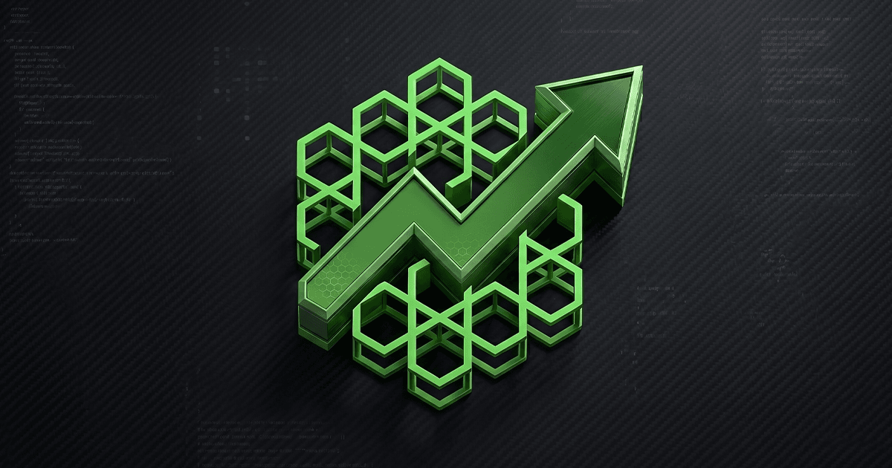

# Densory Tickets — Support & Tickets

 

> Support, Bewerbungen, Meldungen und Bestellungen in einem Bot — Kanal sofort, Fragen per Klick, Team sieht alles auf einer Karte.

Mitglieder wählen im Panel eine Kategorie, der Bot erstellt sofort einen privaten Kanal und führt Schritt für Schritt durch die Fragen, die du im Dashboard festlegst — Buttons, Auswahlmenüs, Formulare, sogar Datei-Uploads. Danach steht alles übersichtlich für dein Team bereit: übernehmen, Priorität setzen, Mitglieder hinzufügen, schließen mit Protokoll und Feedback. Sieben Branchen-Presets (Gaming, Agentur & Handwerk, Shop, Bildung, Event, SaaS) bringen dich in Minuten an den Start; jede Kategorie ist bis ins Detail anpassbar, inklusive Bewerbungstest mit Zeitlimit und vertraulichen Meldungen. Der Bot spricht 29 Sprachen und erkennt die Sprache jedes Mitglieds automatisch.

### 🛒 Im Densory-Shop erhältlich

**[Densory Tickets — Im Shop ansehen](https://densory.com/shop/densory-tickets)**

## Funktionen

- **Sofort-Kanal** — Klick im Panel, Kanal steht — der Rest läuft per Buttons und Formularen.
- **Jede Branche** — Sieben Presets, unbegrenzt eigene Kategorien, Fragen und Abläufe.
- **KI auf Wunsch** — Zusammenfassung, Antwortvorschlag, Übersetzung — Opt-in, redigiert, nie automatisch veröffentlicht.

## Voraussetzungen

- Eigene Discord-Anwendung mit Bot-Token (Message Content Intent im Developer Portal aktivieren)
- Bot-Rechte: Kanäle verwalten, Rollen verwalten, Nachrichten senden
- Eine Kanal-Kategorie für Tickets und optional ein Log-Kanal

## Einrichtung

1. **Bot verbinden**
   Token im Dashboard hinterlegen, Server auswählen, Bot einladen.
2. **Preset wählen**
   Im Dashboard oder per /ticket setup preset eine Branchenvorlage laden und Kategorien anpassen.
3. **Panel posten**
   /panel post im Support-Kanal — Buttons oder Auswahlmenü, Icons nach Wahl.
4. **Team einrichten**
   Staff-Rollen, Log-Kanal, Inaktivitäts- und Protokoll-Einstellungen setzen.
5. **Loslegen**
   Tickets übernehmen, bearbeiten, schließen — jedes mit Protokoll, Feedback und Statistik.

## Konfiguration

Die vollständige Einstellungs-Referenz findest du in [docs/configuration.md](docs/configuration.md).

## Changelog

Siehe [CHANGELOG.md](CHANGELOG.md) und den GitHub-Releases-Tab für die vollständige Versions-Historie.

## Support & Links

- 🛒 [Shop](https://densory.com/shop/densory-tickets)
- 💬 [Discord](https://densory.com/discord)
- ⚙️ [Control Center](https://densory.com/dashboard)

---

_Verwaltet mit dem Densory Control Center: [https://densory.com/dashboard](https://densory.com/dashboard). Erhältlich unter [https://densory.com/shop/densory-tickets](https://densory.com/shop/densory-tickets)._
